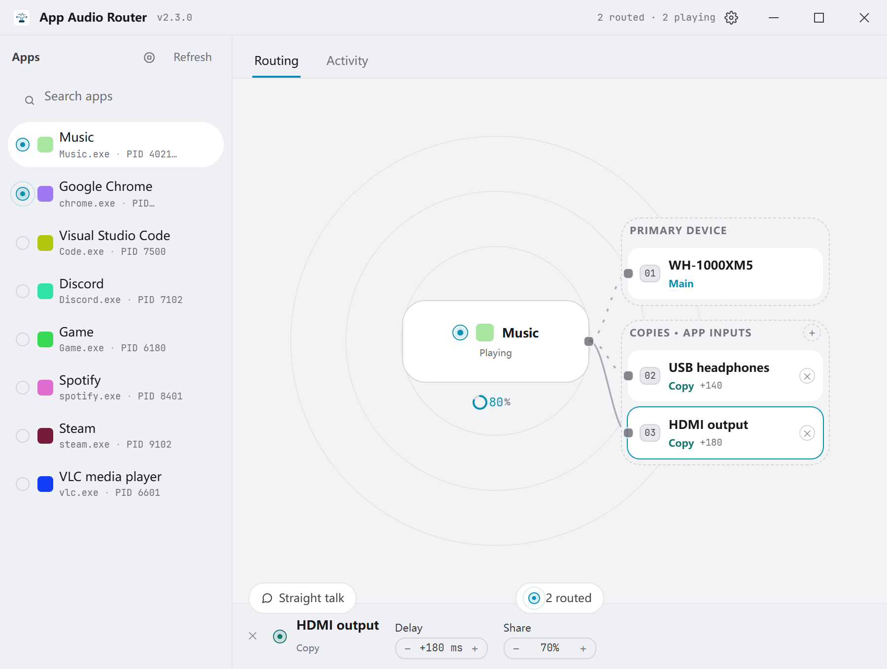
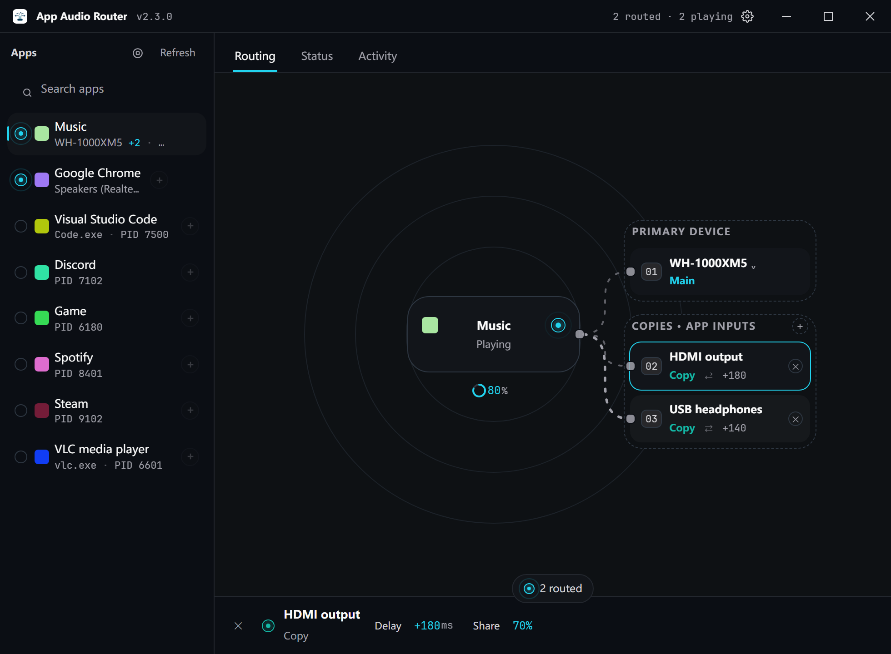

<p align="center">
  
</p>

# App Audio Router

**Per-app audio routing for Windows: send one program's sound to several playback devices at once — each with its own delay compensation and its own volume — or into another program's input.**

<p align="center">
  <a href="https://github.com/Eververdants/AppAudioRouter/actions/workflows/ci.yml"></a>
  
  
  <a href="LICENSE"></a>
  
</p>

<p align="center">
  <strong>English</strong> · <a href="README.zh-CN.md">简体中文</a>
</p>

> **App Audio Router is a free, open-source desktop application for Windows 10 and Windows 11 that routes the audio of individual programs to the playback devices you choose.** It can send one application to several devices at the same time, and it lets you tune each device separately — a delay compensation to line a Bluetooth headset up with wired speakers, and a volume to balance how loud each device is. Everything is done with the Windows Core Audio API from a single native binary: there is no third-party executable to bundle and no driver to install for routing. Feeding one program into another's input runs through a loopback endpoint pair you pick yourself — the app never ships or installs one.

---

## What is App Audio Router?

App Audio Router (**AAR**) is a per-application audio router for Windows. Windows itself only lets an application play to one output at a time; App Audio Router lifts that restriction. Pick a program, pick one or more playback devices, and the program's audio goes to all of them at once — live, without restarting the program.

It is aimed at ordinary users rather than audio engineers. There is no mixer graph and no driver installation: the whole app is one window — the programmes making sound in a sidebar on the left, and beside it a board with the programme you picked on the left-centre and its destinations as a column of numbered cards on the right. A wire from the programme's card to a destination card *is* that part of the route, so "where is this sound going?" is answered by which cards are wired up — and the number on each card is the order they play in, 01 being the device Windows plays itself. A destination can be a playback device **or another program's input**: pick a program's input and its audio is fed there, so Discord can hear Spotify the way a microphone would. A change becomes real only when you click the program's card, and the second tab is a Status page that draws every program's destinations as a row of chips. The activity log sits one tab away.

| | |
|---|---|
| **What it is** | Per-app audio routing tool for Windows (one app → many devices) |
| **Platform** | Windows 10 / Windows 11, 64-bit |
| **Latest version** | 2.3.0 |
| **Installer** | MSI or NSIS setup from [Releases](https://github.com/Eververdants/AppAudioRouter/releases) |
| **Licence** | MIT |
| **UI languages** | English, Simplified Chinese |
| **External dependencies** | None for routing — no helper executable, no driver. Feeds run through a loopback endpoint pair you install and pick yourself |
| **Built with** | Tauri 2, Rust, React 19, TypeScript, TailwindCSS, Vite |
| **Source code** | https://github.com/Eververdants/AppAudioRouter |

## Screenshots

The same board in both themes: `Music.exe` is the programme being looked at, so its card sits left of centre and its three destinations are numbered rows in the two dashed panels on the right — 01 is the system's own playback (the Bluetooth headset, *Main*) in the upper panel, 02 and 03 are copies this app duplicates to, each with its own delay, in the lower one. The sidebar lists the programmes making sound, with each routed one marked by its ring, and the strip along the bottom holds the levers of whichever row's number was clicked — for a copy, its delay and its share. The title bar keeps the count: two routed, two playing.





## Features

### Routing

- **One app → many devices.** Pick a programme in the sidebar — and the circular button at the end of any other row adds that programme to the same change — then add the devices it should play through with "+ Add destination"; the audio is mirrored to all of them at once.
- **Applies immediately.** A running program is re-pointed to the selected devices without a restart or a settings dialog reboot.
- **Ordered targets.** The first device becomes the program's native endpoint, handled by Windows itself; every further device receives a real-time copy of the stream.
- **Stop on demand.** Stop routing and the program is handed back to the system default device — the fixed output device Windows took while the route was live is released again, so switching the default device by hand keeps moving that program.
- **Nothing left behind.** The only trace of a route is an output device Windows fixes for the program while it is routed. Stopping the route, quitting the app and **Settings → Reset per-app output** each give it back, and a program that exited while routed gets its device back the next time it plays.
- **Auto-remember.** Routing rules are stored per executable name and restored when that program plays again.
- **One app → another app's input (2.3.0).** The same "+ Add destination" picker lists every program that can take sound in; choosing one connects it there on the spot — no hub press, and the toast offers the way back. It runs through the endpoint pair a loopback driver provides, picked once in Settings; this app ships no driver and installs none. Until that pair is configured the rule is still remembered and the row on the board reads *No carrier* instead of pretending sound is moving.
- **A mirror that fails says so.** If one device of a multi-device route cannot be opened, the engine keeps playing on the others and the log names the device that went silent — a route that is only half alive should not look fully applied.

### Per-device fine-tuning

- **Delay compensation** — a signed millisecond value per device to align a fast device with a slow one, for example wired speakers against a Bluetooth headset whose codec adds inherent latency. The step is configurable (1/10/50/100/1000 ms, 10 ms by default), and **Settings → Delay compensation → Calibrate** plays short tones on each device to measure how late you really hear it, then writes the values itself.
- **Volume balance** — a 0–100 % value per device that attenuates that device relative to the loudest copy in the route, so a quiet headset and a loud speaker rig can be brought in line. The device Windows plays directly gets a volume of its own: it moves the program's session volume, and the copies are compensated for it automatically, so it changes the main path alone.
- **Reported latency** — the software-side latency each device is actually playing at, measured from the running stream. It is a reading and not a setting, so it lives in the tooltip of the delay value rather than beside it: the cell holds the value you asked for, and the tooltip holds what you got.
- **Stepped, not scraped** — each value moves with the `−` and `+` beside it: delay by the configured step up to ±10 s, level by 5 % between 0 and 100 %, both stopped at the ends. They are buttons rather than drag surfaces because these two change what you are hearing, and resting a finger on a scroll wheel should not be able to move them.
- **Only where they can act** — click a copy's number badge and the strip below hands you its delay and its volume share; the main device's card offers a volume of its own (the program's session volume, compensated so the copies stay put) but no delay, because nothing of this app's sits on its path to hold back. A single-device route starts no engine, so its number is not a button at all and the strip offers no device panel — a greyed-out control that could never work would promise otherwise.

### Stays out of the way

- **Live lists.** The device list and the process list follow the audio engine on their own — plug in a headset, or start and stop playback in an app, and both lists update without pressing anything. This uses Core Audio's own change notifications, not a polling timer.
- **One copy, one tray icon.** Launching the app again does not start a second process: the copy already running brings its window to the front instead. Two instances would fight over the same configuration files and the same audio devices.
- **System tray.** A tray icon appears while the app runs: left click shows or hides the window, the right-click menu has *Show / hide*, *Open settings*, *Start with Windows*, *Stop all routes* and *Quit* — in the interface's own language.
- **Close to tray.** Optionally, the close button hides the window instead of quitting, so routing keeps running with no window on screen. Off by default; `Quit` is the action that stops the routes.
- **Start with Windows.** Optionally registers the app under your user's startup entries (`HKCU\Software\Microsoft\Windows\CurrentVersion\Run`), launching silently into the tray so remembered routes are ready before you open anything. Turn it back off from the same switch, or from Task Manager → Startup apps.

### Interface and overhead

- **A board, not a form** — the process list is a sidebar, and the routing screen is a node board: the programme you picked is a card left of centre, its destinations are numbered rows inside two dashed panels on the right (the main device in the upper one, the copies and the programmes it feeds in the lower one), and a wire from the programme's out-pin to a destination's in-pin *is* that part of the route. **The number on a card is the order it plays in**: 01 is the one Windows plays itself (accent), everything after it is a copy (teal), and a copy is the only place delay and a share exist, because it is the only place there is a stream of ours to hold back or attenuate. Nothing takes effect until you click the programme's card, and nothing can leave a programme with nowhere to play — the last device card cannot be removed. Devices no route touches are not on the board at all, which is most devices most of the time. A programme playing to several devices carries its own level as a ring under its card, and the title bar keeps a quiet count — *2 routed · 2 playing*. Solid panels and hairlines, sentences instead of pills, monospaced figures for every value, and generous continuous-curvature corners.
- **Process list search** — filter the list by name as you type, with the programs that are currently routed kept at the top so the one you are working with does not move under the cursor. `Escape` clears the search.
- **Light and dark themes**, English and Simplified Chinese, both switchable from the title bar; the preferred theme and language are applied before the first frame paints, so there is no flash on startup.
- **Low background cost** — the app never polls the audio engine. It registers for change notifications and re-reads the lists when Windows says something actually moved, and each re-read that turns up no visible change is not even logged. The interface has exactly two things that move on their own: the dash running along the wires of a programme that is sounding, and the pulse on the ring beside a programme that is — only while the window is visible, focused and free of the system's reduced-motion request; hidden, unfocused or silent, everything stands still and nothing repaints. An active route is idle when its program is, too: a routed program that has produced no sound for a second and a half stops being fed to its mirrored devices, rather than having silence written at them a hundred times a second apiece.
- **Fast cold start** — the window is created hidden and is revealed once the first frame is on screen (with a watchdog on the Rust side as a fallback), device enumeration waits for the first paint to be idle, and the release profile is tuned for a small, dense binary (LTO, one codegen unit, symbol stripping, `panic = "abort"`).

## How it compares to other options

| Capability | **App Audio Router** | Windows built-in per-app output | Virtual-cable mixer (Voicemeeter / VB-CABLE class) | Per-app default switcher (EarTrumpet class) |
|---|---|---|---|---|
| One app → several devices at once | **Yes** | No — one output per app | Yes, through mixer buses | No |
| Applies to an already-running app | **Yes** | Yes | Yes | Yes |
| Per-device delay alignment for Bluetooth | **Yes** — signed milliseconds per device | No | Manual, configured per bus | No |
| Per-device loudness balance | **Yes** — 0–100 % per device | No | Yes, via bus gain | No |
| Per-program level balance | **Yes** — 0–400 % per program, dialed on its node, aligned in one click | No | Yes, but every strip is set by hand | No |
| How many programs and devices at once | **No built-in limit** — each routed program is its own engine | — | A fixed number of buses (3/5/8 by edition) | No |
| Remembers the route per application | **Yes**, automatically | Yes (this is the same Windows setting) | Configured in Windows, not in the mixer | Inherits the Windows per-app setting |
| One app → another app's input | **Yes** (2.3.0, through a loopback endpoint pair, applied on selection) | No | No | Yes (virtual channels) |
| Requires a virtual audio driver | **Routing: no. Feeds: a loopback pair you install** — the app itself ships and installs no driver | — | Yes | — |
| Cost | **Free, MIT licensed** | Bundled with Windows | Free or pay-what-you-want | Free, MIT licensed |

*The other columns describe publicly documented behaviour of those approaches; check their own documentation for the current feature set.*

## Requirements

- **Windows 10 or Windows 11, 64-bit.**
- WebView2 runtime — already present on Windows 11 and on any Windows 10 with Microsoft Edge installed.
- That is all for the installed build: no audio driver, no service, no third-party executable. (Feeding one program into another's input uses a loopback endpoint pair *you* install and name in Settings — the app bundles no driver and runs no installer.)

To build from source you additionally need Node.js 20 or later, pnpm 10, and a stable Rust toolchain with the MSVC target and the WebView2 build tools that Tauri uses.

## Install

1. Open the [Releases](https://github.com/Eververdants/AppAudioRouter/releases) page.
2. Download the `.msi` installer (or the NSIS `.exe` setup) from the newest release.
3. Run it and launch **App Audio Router**.

Prefer building it yourself? See [Build from source](#build-from-source).

## Quick start

1. **Play some sound in the app you want to route.** A program only appears in the process list while it has an active audio session — audio routing is per session, not per shortcut.
2. **Pick it in the sidebar.** One programme at a time is what the ring shows; the circular button at the end of another row adds that programme to the same change.
3. **Add the devices it should play through.** The device already at the head of the plan is the one Windows itself drives, and every one you add after it receives a copy carrying its own delay and share. Tapping a copy's role word hands it that seat; the main row's own picker can take it further. The last one cannot be removed: a programme with nowhere to play is not a state this app offers.
4. **Click the programme's card.** While a change is waiting, the hub wears a "click to apply" badge, and its accessible name says exactly what the click will do. Once the route is live, the wires to those destinations stay on the board, and they flow while the programme is sounding.
5. **Tune a copy if you need to** — its number badge opens its delay and share in the strip along the bottom.
6. **Or feed another programme's input** — the same "add destination" card lists every programme that can take sound in; picking one stages it on the plan, and the same press that lands a device route connects it (✕ the row and press the card again to take it back out — no undo toast rides a feed). The feed is **one more destination, not a move**: the engine writes a second copy of the programme's audio into the carrier, so the programme keeps playing on its own device and a device route is not disturbed.
6. **Turn on Auto-remember** in the settings so the route is restored the next time that program plays.

## Delay compensation explained

Two speakers playing the same audio will not sound in sync if one of them is a Bluetooth headset: the codec and the headset's own buffering add latency that the wired path does not have. Delay compensation makes the audio arrive at both devices at the same moment.

- **Every device carries its own signed value in milliseconds**, measured against the application's audio — not against another device.
- **Positive holds that device back; negative marks it as the earliest device in the route**, which lifts the others instead.
- **Software delay can only be added, never removed.** The earliest device of the group is therefore the reference: it is the one Windows plays directly, and every other device is held back by the difference. The relative difference you configure is reproduced exactly; the absolute value is normalised to the earliest device.
- **The route is applied in delay order**, so the earliest device normally becomes the primary (the one Windows drives). Lowering a delay while a route is running simply shifts the whole group instead of glitching.
- **The assistant measures it for you.** Settings → Delay compensation → **Calibrate…**: tick at least two devices (the ones in a live route start checked), and they play short tones **round by round** — a fresh order each round, so the drift of a long session lands on every device alike. Tap the button once for every tone you hear — a tap that answers nothing does not count and leaves that tone for the next try; each device keeps going until it has three readings worth using. Only the *differences* between devices are used, so your own reaction time sits in every measurement equally and cancels; **the device that sounded last becomes the alignment reference** (it ends at 0, the seat the engine can fully align to), and every other device receives its difference minus the 100 ms of pipeline a copy holds anyway. Tapping a row on the results screen re-picks that reference — the numbers are all relative to each other, so it is arithmetic, not a re-measure. The wizard writes delay values and nothing else: it never reorders a live route, so make the reference the first device of a route when you want Windows to drive it. Nothing is guessed from the device's type, and if the result is still a hair off you can nudge it on the board's tuning strip.
- **Step, and a ceiling.** The step is yours to set (1/10/50/100/1000 ms, 10 ms by default). There is no configurable range any more: a delay is held inside ±10 s, which is the width the engine's ring buffers are sized for.
- **A delay needs something to delay.** It is realised by the mirrored copy, so it exists only when at least one further device receives a copy. Route a program to a single device and Windows plays it directly: the board offers no tuning strip for it at all — its number is not a button — rather than a control that could never work shown as if it could. The value is kept for when you add a second device, and the per-device list in Settings edits the same number either way.

## Volume balancing explained

Delay fixes *when* the audio arrives; the volume value fixes *how loud* each device is.

- **Each device holds a 0–100 % value.** 100 % leaves the device exactly at the level the application produced; lower values attenuate it. 0 % is silence.
- **The value is relative to the loudest copy in the route.** The engine scales each mirrored copy by `own / max`, so software gain only ever attenuates and the loudest copy is the reference the others are brought down towards. The device Windows plays itself is not in that comparison — its loudness is the program's session volume, a different lever (next bullet).
- **The primary device gets a volume of its own**, and it works through the program's session volume — the slider the Windows volume mixer shows for that program, which is the one lever that reaches the device Windows plays itself. The copies are compensated for it automatically, so it changes the main path alone. Stopping the route hands the program's previous loudness back, and so does quitting the app. It stops at 5 %: at 0 the audio this app captures would be true silence, and no gain could give the copies their loudness back.
- **Like delay, it needs a mirrored copy to act on.** In a single-device route there is no copy and nothing is attenuated, so the board shows no share row for it — a value that does nothing is never displayed as though it were doing something. The per-device value stays put for when a second device joins the route.
- Volumes are stored per device and pushed to any route that is already running, so a change is audible immediately.

## What the reported latency means

The delay value is what you asked for; the reading in that value's tooltip is what the device is doing right now.

- **It is measured per device, from the running stream** — the engine's own pipeline for that device (its base latency plus whatever delay compensation that device is under) plus the latency the endpoint reports for its own stream. It follows the values you set rather than restating them, so changing a delay moves the number.
- **The device Windows plays directly does not report one.** There is no stream of ours on that device to measure, so rather than inventing a figure the tooltip says it cannot be measured.
- **Whatever a codec or a Bluetooth link adds is on top of this, and is not in the number.** That part is not observable from a user-mode program and is not guessed at — treat the figure as a floor for the path, not as the whole of it.

## Level alignment explained

Delay fixes *when* the audio arrives and the device volume fixes *how loud each device* is. Neither of them touches the other problem: one application is simply quieter than another, a game's mix against a voice chat's.

- **Each program carries a 0–400 % level of its own**, applied by the engine to that program's audio on its way to the devices it is duplicated to. 100 % leaves it exactly as the program produced it; below that attenuates, above it amplifies. This is not the application's own volume and never changes it — nothing outside this app sees it, and nothing about it is stored in Windows. Like the device volume and the delay, it acts on the mirrored copies, so the device Windows plays directly is not affected by it.
- **One click aligns all of them.** Every routed program that is currently playing is brought to the loudest one's level, less a small headroom margin.
- **Nothing it measured can clip.** Each gain is bounded by that program's own measured peak — a gain of `1/peak` puts its loudest sample at full scale and cannot put anything past it — and by a ceiling, because past roughly +12 dB a program's noise floor comes up along with its signal. That is why none of this needs a limiter. The bound is against the material that was playing when it was measured, though, and the gain is then stored and reused: a program that was quiet then and is loud later can still be pushed into clipping, so turn it down if you hear it.
- **A program that is not playing is left exactly as it was**, and the log names it. Aligning against silence would be aligning against nothing.
- **Several programs at once still add up at the device**, and that sum happens inside the Windows mixer where this app cannot see it. The headroom margin is a courtesy rather than a guarantee: with many programs playing together, the device volume is still the control that has to move.
- **Only routed programs have a level**, because the level is applied by the engine to the audio it has captured. A program routed to a single device has no engine either — Windows plays it directly — so its node carries no ring. Route it to a second device first and the ring appears.

## How it works

| Step | What happens |
|---|---|
| 1 | `IMMDeviceEnumerator` enumerates the active render (playback) endpoints. |
| 2 | `IAudioSessionEnumerator` enumerates the processes that currently hold an audio session. |
| 3 | `IPolicyConfig` points the selected process's session (for all roles) at the chosen endpoint — the same mechanism Windows' own per-app output setting uses. |
| 4 | For each further device, a **WASAPI process-loopback** capture client for that PID feeds an `IAudioClient` render client on the target device. Delay is implemented as ring-buffer backlog (silence is prepended, never appended, so raising a delay never lets a burst of audio through first); volume is a per-sample gain applied before the samples are written. |
| 5 | Sample formats are parsed from the endpoint's `WAVEFORMATEX` — float32, float64 and PCM 16/24/32 are scaled; anything unrecognised is passed through untouched rather than mangled. A gain of exactly 1.0 short-circuits, so at 100 % the path costs nothing. |
| 6 | Routing rules, delays and levels are persisted as JSON in the application data directory (`route-memory.json`, `device-delays.json`, `device-volumes.json`, `primary-volumes.json`, `source-volumes.json`). |
| 7 | Each duplication engine reports its end (stopped by the user, the process exited, or an error) through a `duplication-stopped` event, and routes that outlived an app restart are reconciled on boot so the badges match reality. A single device that cannot be opened is reported on its own channel instead (`duplication-mirror-failed`), because the engine carries on for the rest of the route and the UI has to say which device went quiet. |

Routing rules are keyed by **executable name**, not by PID, so a remembered route survives restarts.

## Tech stack

| Layer | Technology |
|---|---|
| Desktop framework | Tauri 2 |
| Frontend | React 19 + TypeScript (strict) |
| Styling | TailwindCSS 3 (utility-first, CSS variables) |
| Animation | Motion (`framer-motion`) |
| Build | Vite 6 |
| State | Zustand |
| i18n | i18next / react-i18next (English, Simplified Chinese) |
| Backend | Rust (edition 2021) with the official `windows` crate — Core Audio, no third-party audio code |

## Project layout

```
AppAudioRouter/
├── src/                          # React frontend
│   ├── components/
│   │   ├── NodeStage.tsx         # the node board: the picked programme's card on the left-centre, its destinations as numbered rows in two dashed panels on the right (devices, or another programme's input), a wire per route; the tuning strip for the row that was clicked
│   │   ├── ProgramRail.tsx       # programmes with an audio session, and whether each one joins the change
│   │   ├── BriefingPage.tsx      # the Status tab: every redirected programme as a row of destination chips
│   │   ├── SourceLevelDial.tsx   # a programme's own level, as a ring under the hub
│   │   ├── DelayCalibration.tsx  # the delay assistant: round-robin tones, held presses, results you can re-base
│   │   ├── SettingsPage.tsx      # a section rail beside the chosen section's rows
│   │   ├── LogPanel.tsx          # activity log (the third tab)
│   │   ├── TitleBar.tsx          # custom frameless title bar, with the routed/playing count
│   │   ├── Toast.tsx             # the transient undo offer after a route, plus the failure notices
│   │   ├── StartupWizard.tsx     # the startup tour: four steps on a fresh install; upgrades add a "keep the old settings?" screen and, where needed, the legacy-endpoint reset
│   │   └── ui/                   # Ring, Switch, UnderlineTabs, SegmentedControl, Select, Tooltip, ConfirmButton, …
│   ├── hooks/                    # useTheme, useLanguage, useDelayValue, useBackendEvent, useLiveness,
│   │                             #   useProgramRoutes, useElementHeight
│   ├── stores/routerStore.ts     # Zustand store
│   ├── i18n/locales/             # en.json, zh-CN.json
│   ├── lib/                      # invoke wrapper, per-program route lookup, stage geometry, delay maths, shared types
│   └── styles/index.css          # Tailwind entry + theme CSS variables
└── src-tauri/                    # Rust backend
    └── src/
        ├── main.rs               # entry point, command registration, close-to-tray, releasing everything on exit
        ├── commands.rs           # Tauri commands (invoke handlers)
        ├── config.rs             # route / delay / volume / shell-settings persistence
        ├── tray.rs               # tray icon, its menu, show and hide
        ├── autostart.rs          # HKCU Run entry for start-with-Windows
        ├── install.rs            # first-run / after-update notice, decided before the window exists
        ├── single_instance.rs    # named mutex + event, so a second launch raises the window
        └── audio/
            ├── devices.rs        # IMMDeviceEnumerator
            ├── sessions.rs       # IAudioSessionEnumerator
            ├── process_meta.rs   # window title, file description, icon extraction
            ├── routing.rs        # IPolicyConfig per-process routing
            ├── duplication.rs    # WASAPI process-loopback duplication engine
            ├── calibration.rs    # the calibration tones the assistant times itself
            ├── levels.rs         # per-source level table (readings no older than a second)
            └── notifications.rs  # endpoint + session change callbacks
```

Every module above that outgrew one screen is a file of its own name plus a folder of the same
name — `commands.rs` + `commands/`, `config.rs` + `config/`, `audio/routing.rs` +
`audio/routing/`, `audio/duplication.rs` + `audio/duplication/`, and on the frontend
`stores/routerStore.ts` + `stores/router/`, `components/NodeStage.tsx` +
`components/nodeStage/`, plus the same for the settings page and the calibration
wizard. The folder contents are listed in AGENTS.md.

## Build from source

```bash
git clone https://github.com/Eververdants/AppAudioRouter.git
cd AppAudioRouter
pnpm install

pnpm tauri dev        # dev build with hot reload
pnpm tauri build      # installers in src-tauri/target/release/bundle
```

Useful checks, all of which also run in CI:

```bash
pnpm fmt:check                   # prettier, including Tailwind class order
pnpm typecheck                   # tsc --noEmit
pnpm build                       # tsc -b && vite build
pnpm test                        # unit tests (Vitest, against a fake Tauri IPC)
pnpm test:e2e                    # end-to-end (Playwright; it starts the dev server itself)
cd src-tauri
cargo fmt -- --check
cargo clippy -- -D warnings
cargo check
cargo test
```

CI runs the frontend checks, the unit tests and the end-to-end tests on Linux, and `cargo fmt` / `check` / `clippy` / `test` on Windows — on every push and every pull request. A tagged release runs `cargo audit` first, then builds the installers.

## FAQ

### Is App Audio Router free?

Yes. It is open source under the MIT licence, and there is no paid tier or account.

### Can I send one application to two (or more) audio devices at the same time?

Yes — that is the main reason the app exists. Select several devices on the board and confirm; the first device is driven natively by Windows and every additional device gets a mirrored copy of the same stream in real time.

### Does it need a virtual audio driver such as VB-CABLE?

No. All routing, duplication, delay and gain is done by calling the Windows Core Audio API directly from the app's Rust binary. Nothing is installed into the audio stack, and uninstalling the app leaves no driver behind.

### Will it work with a program that is already running?

Yes. Routing is applied to the live audio session, so the program does not need to be restarted — a game or browser tab keeps playing while it moves to the new device.

### After I stop a route, does the program follow the system default again?

Yes, and that is the point of 2.1.1. While a program is routed, Windows has a fixed output device stored for it — that is the mechanism that moves a running program's audio — and that stored device outranks the system default. Stopping the route, quitting the app and **Settings → Reset per-app output** each release it, so the program follows the default device again, including every device you pick afterwards. If Windows refuses to release it, the log says which device the program is still fixed to instead of pretending the route is gone; the volume mixer's own **Reset** for that app clears it too. 2.1.0 — the release that introduced that stored device — left it in place after a stop, which is why a program could keep playing to the old device, or ignore your device switches, until the reset was done. Versions before it stored nothing to leave behind, and every release from 2.1.1 on gives the device back on all four paths.

### What does the app say on the first launch after an update?

One thing, once: the tour. The first time 2.3 or later runs on a machine — a fresh install, or one coming from any older version — the app opens its full-screen tour instead of the window you know. An upgrade answers one question first: **keep the previous version's settings** (the routes and feeds it remembered, the delay compensation, device shares and program levels) or start clean. Windows also stores a program's output device per executable and keeps that stored device after the program exits, so the one version that stopped a route without handing it back (2.1.0, the release that introduced those stored devices) can leave a program fixed to one device — it stops following the devices you switch to in Windows, and no reboot helps. Nothing in the app can tell such a leftover from an assignment you made by hand in the volume mixer, so the machines that could have one get one more tour screen offering **Reset per-app output**; ignore it if no program is misbehaving. Coming from 2.1.1 or later, that screen is not there — those releases returned what they pinned. Once a version has run here the tour is done and never comes back; later updates say nothing at all. The version that last ran is recorded in `install-state.json`, and the tour's steps are written to the log.

### Can it fix the delay between a Bluetooth headset and wired speakers?

Yes, that is what delay compensation is for, and the assistant in Settings can measure it rather than leave you to estimate: give the faster device the difference as a positive delay (the assistant writes `+180 ms` or whatever the tones say). Positive values hold a device back; a negative value marks it as the earliest device in the route.

### Why is my application not in the process list?

A program only shows up while it holds an active audio session, so start playback in it — the list notices on its own, or press **Refresh**. Programs that use ASIO or WASAPI exclusive mode never create a session with the system audio engine and will not appear, and system-critical processes are deliberately excluded from routing.

### Where are the settings stored?

In plain JSON files in the application data directory: `route-memory.json` (executable → device list), `device-delays.json` (device → milliseconds), `device-volumes.json` (device → percent), `primary-volumes.json` (executable → the program's primary volume, in percent), `source-volumes.json` (executable → level percent, which may be above 100), `app-settings.json` (whether the close button hides the window to the tray) and `install-state.json` (the version that last ran, which is how the app tells an update from a fresh install). Theme and language are browser-side preferences of the window itself, kept in its local storage. The one thing outside those files is the optional startup entry under `HKCU\Software\Microsoft\Windows\CurrentVersion\Run`, which is also what the "Start with Windows" switch reads back. Remembered routes are keyed by executable name, so they apply to the program wherever it is launched from.

### Can the delay calibrate itself automatically?

Close enough that you rarely have to do it by hand. **Settings → Delay compensation → Calibrate…** plays three short tones on each device in turn and times when you actually hear them: tap the button the moment a tone sounds, and the taps that do not line up with a tone are dropped rather than averaged in. Because only the *difference* between two devices is ever used, everything the measurements share — your own reaction time above all — cancels, and the device that turned out slowest becomes the reference the others are held back against. Applying writes the numbers into the same delay settings the rest of the interface edits, so you can still nudge them afterwards.

What it cannot produce is an absolute figure for one device on its own, and that is not a gap: an absolute number would have to contain the very reaction time that cancels out of a difference. It also measures with the speakers playing into the room, so whatever you can hear — the Bluetooth codec, the endpoint pipeline, the hardware's own buffering — is in the number.

### Can it give me more channels than a virtual-cable mixer?

There is no channel count to raise, because this is not a bus mixer. Each routed program gets its own engine instead of a strip on a shared bus, so the programs are independent of one another and nothing caps how many of them — or how many devices — you route at once. That also means there is no bus count to run out of, which is the limit people hit with Voicemeeter's three, five or eight buses.

### Why is a program missing from the level list?

Because it is not being routed. The level is applied by the duplication engine to the audio it has already captured, so a program with no engine has no such path and nothing to set. Route it first, then set or align its level.

### Does the level change my application's own volume?

No, and that distinction is deliberate. The level is a gain this app applies to the audio it captured from that program, on its way to the devices it was duplicated to; the program itself, and anything Windows stores about it, is untouched. Take a program's level down to silence and its own volume slider has not moved — though note that, like the device volume and the delay, it does not reach the one device Windows plays directly.

### Does it run in the background or poll the audio devices?

It never polls, and there is no service. The app registers for the audio engine's own change notifications and re-reads a list when Windows reports that something moved — that is how the device and process lists stay current on their own. Otherwise it talks to the audio engine only when you refresh a list, change a device value or apply a route. While a route is active, the duplication engine for that process runs; when you stop routing, the engine is torn down.

While a route is active, the engine is only as busy as the sound it carries. An audio device has to be fed every few milliseconds for as long as a stream is open, so an engine that kept writing silence at a program that was not playing would hold the CPU out of its low-power states indefinitely — a cost that shows up as fan noise rather than in any CPU figure. So when a routed program has produced nothing for a second and a half, the engine stops feeding its mirrored devices and parks until the program plays again. The first sound after a pause comes out at the same latency as any other, because the pipeline depth is rebuilt before the device is fed again.

The interface is not left redrawing anything either: there is no decorative animation to leave running — no drifting backdrop, nothing that moves because it looked nice. Exactly two things move, because each reports something true: the dash running along the wires of a programme that is sounding, and the pulse beside one that is. Both stop existing the moment nobody is watching — window hidden, focus elsewhere, or the system asking for less motion — so a resting window repaints nothing at all.

### Can I run two copies of the app at once?

No, and deliberately so. Starting the app again when it is already running brings the existing window to the front instead of starting a second process: two instances would fight over the same configuration files and the same audio devices, and a second tray icon for one routing engine is nothing but a way to lose track of which copy is doing what. A second launch during a silent start-with-Windows start raises the window too, so you are never left clicking a shortcut that appears to do nothing. (A separate Windows logon session, such as a second RDP session, gets its own instance — the audio engine is per session, so there is nothing for them to fight over.)

### One device in my route is silent — how do I find out which?

The log tells you. A device that could not be opened for mirrored playback drops out of the route's device count and produces an entry naming that device and the error, while the remaining devices keep playing. Nothing is retried behind your back; re-apply the route (or re-plug the device) once it is available again.

### Does the app keep routing after I close the window?

By default, closing the window quits the app, and a route that needed a mirrored copy stops with it — every program the app had fixed to a device is handed back to the system default on the way out. Turn on **Settings → Background → Minimize to tray when closed** and the close button hides the window instead: routing keeps running and the tray icon brings the window back. **Quit** in the tray menu always stops everything, switch on or off.

### Can it start automatically with Windows?

Yes. **Settings → Background → Start with Windows** adds a single value for your own user under `HKCU\Software\Microsoft\Windows\CurrentVersion\Run`; nothing is written to `HKLM`, no administrator rights are needed, and no window opens — it launches into the tray so remembered routes are ready first. The app reads that registry value back rather than a copy of its own, so if you toggle startup off in Task Manager, the switch shows that.

### Is macOS or Linux supported?

No. The routing mechanism is built on Windows Core Audio, so the app is Windows-only (Windows 10 and 11, 64-bit).

## Limitations and notes

- A program must be running and producing sound to appear in the process list — routing works on live audio sessions, so a program that never plays any has nothing to move.
- Remembered routes are matched on executable name, not on a path or a PID.
- Delay compensation can only *add* latency. The earliest device of the group is the alignment reference and cannot be pulled earlier — that is why routing is applied in delay order.
- A mirrored copy is buffered for stability (about 100 ms of pipeline latency) so that all mirrors play the same sample at the same moment. Alignment between mirrored devices is exact; the offset to the primary device, which Windows plays natively, is inherent to capturing and re-rendering the stream.
- Calibration times your own presses against the tones each device plays, so it measures the room you are actually listening in and is only as good as your timing. A delay is held inside ±10 s: a value beyond that is refused rather than silently clamped, because that width is what the engine's buffers are sized for.
- Volume can only attenuate, so the loudest copy in the group is the reference and cannot be pushed below the level the application produced on it.
- Delay and volume act on mirrored copies only, so neither does anything in a single-device route; the values are kept for when you add a second device.
- A feed is a second copy (one tap inside the engine), so the target hears the programme about 100–140 ms later than the programme's own output does. The programme's own path carries none of that.
- Routes for system-critical processes are refused rather than half-applied.
- A routed program carries a **fixed output device** while its route is live, and Windows keeps that device stored per executable — even after the program exits. It is given back when the route stops, when the app quits, when the program is next seen playing after having exited while routed, or by **Settings → Reset per-app output**. A program that an earlier version left fixed keeps ignoring the system default until one of those happens (the volume mixer's own **Reset** for that app works too).
- Releasing a fixed output device needs the program to be running, because the audio service is addressed by process; a program that is closed keeps its device until it plays again.

## Contributing

Issues and pull requests are welcome at [Eververdants/AppAudioRouter](https://github.com/Eververdants/AppAudioRouter). Commits follow [Conventional Commits](https://www.conventionalcommits.org/) and are kept small and focused, one concern per commit; the conventions used across the codebase are documented in [AGENTS.md](AGENTS.md).

## License

[MIT](LICENSE) © 2026 Eververdants
